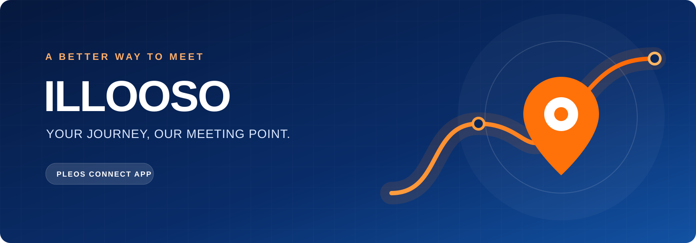
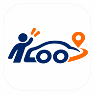
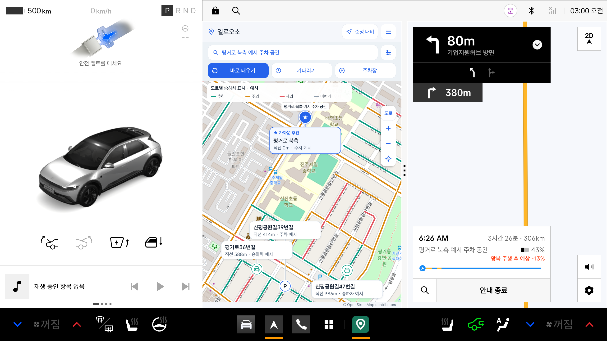
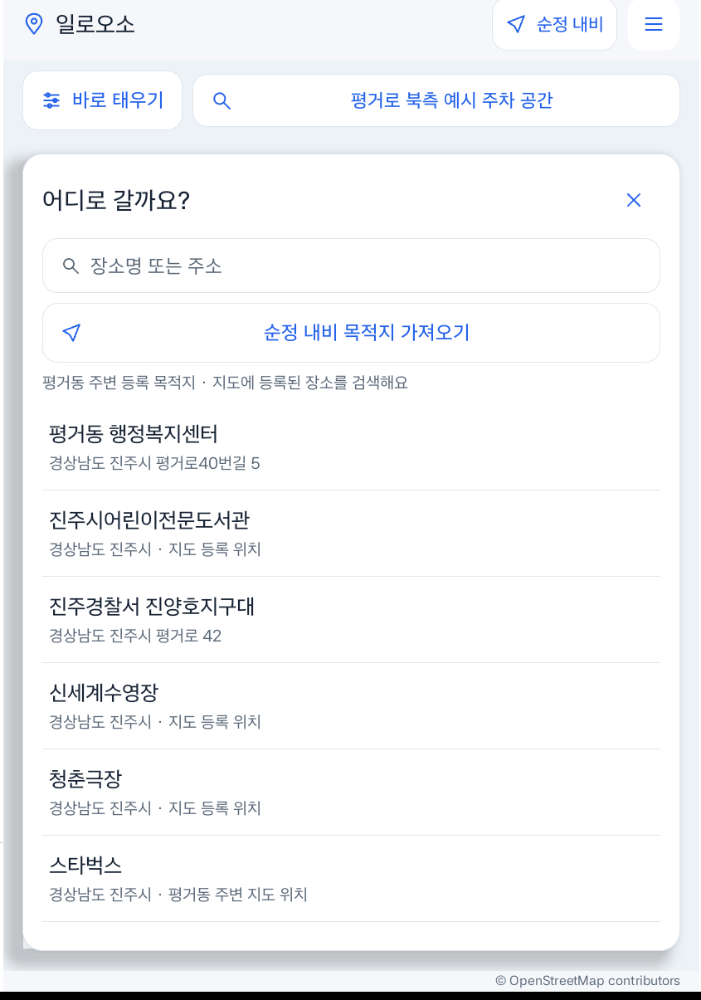
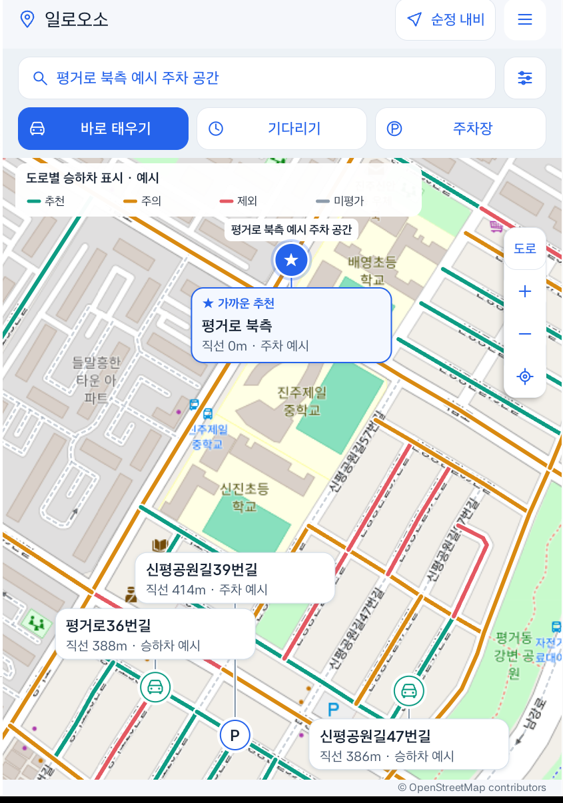
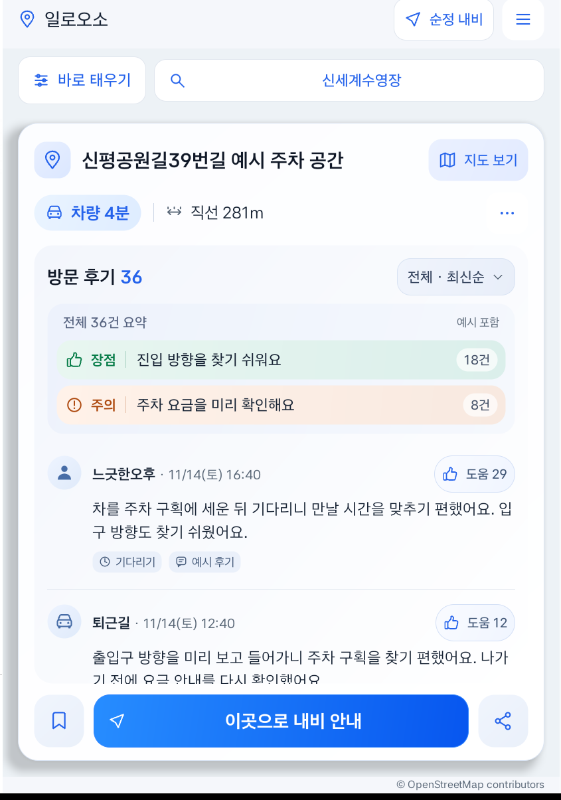
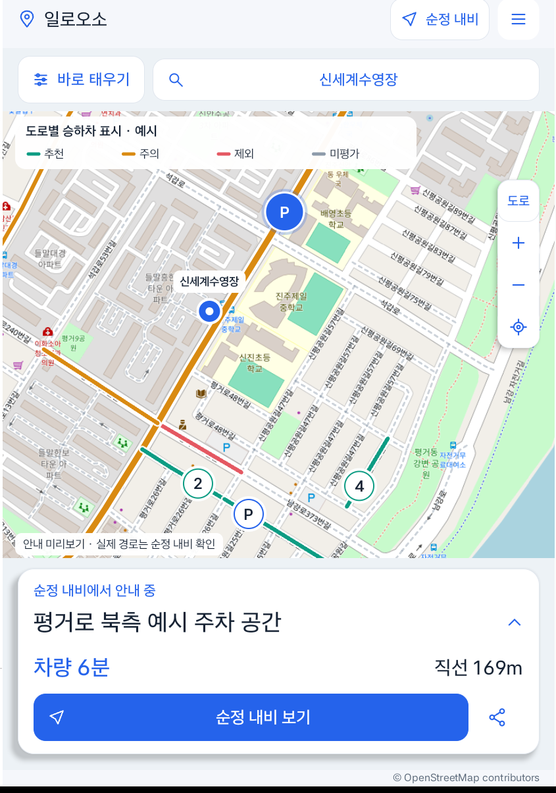

<div align="center">
  
  <br /><br />
  
  <h1>일로오소 <sub>ILLOOSO</sub></h1>
  <h3>우리의 만남을 더 편하게.</h3>
  <p>목적지 주변의 승하차·대기·주차 후보를 살펴보고<br />운전자와 동승자가 만날 곳까지 연결하는 차량용 앱</p>
  <p>
    
    
    
    
  </p>
  <p><a href="#-서비스-미리보기">서비스 미리보기</a> &nbsp;·&nbsp; <a href="#-핵심-기능">핵심 기능</a> &nbsp;·&nbsp; <a href="#-시작하기">시작하기</a> &nbsp;·&nbsp; <a href="https://app.notion.com/p/41388b2f14b180818a8ec3bc0078d4f0">기획서</a></p>
</div>

<br />

> **“어디에서 만날까?”라는 마지막 고민까지, 이동 경험의 일부로.**<br />
> 일로오소는 최종 목적지 주변에서 만날 곳을 찾고, 비교하고, 차량 내비게이션으로 안내받는 과정을 하나의 화면 흐름으로 연결합니다.

## ✦ 서비스 미리보기

<div align="center">
  
  <p><sub>실제 Pleos AVD 실행 화면 · 차량 화면 안에서 주변 장소를 탐색합니다.</sub></p>
</div>

<br />

<table>
  <tr>
    <td align="center" width="50%"><b>01 &nbsp;목적지 선택</b><br /><sub>검색하거나 순정 내비 목적지를 가져와요</sub></td>
    <td align="center" width="50%"><b>02 &nbsp;주변 장소 탐색</b><br /><sub>방문 목적과 조건에 맞는 후보를 살펴봐요</sub></td>
  </tr>
  <tr>
    <td align="center"></td>
    <td align="center"></td>
  </tr>
  <tr>
    <td align="center"><b>03 &nbsp;이용 정보 확인</b><br /><sub>장소 정보와 후기를 한곳에서 확인해요</sub></td>
    <td align="center"><b>04 &nbsp;내비게이션 연결</b><br /><sub>선택한 만남 장소를 순정 내비에 전달해요</sub></td>
  </tr>
  <tr>
    <td align="center"></td>
    <td align="center"></td>
  </tr>
</table>

> 화면은 실제 앱 캡처입니다. 현재 평거동 일대의 프로토타입으로, 승하차 후보·정차 적합성·운영 정보·후기는 예시 데이터입니다. 실제 정차 가능 여부와 현장 안전은 확인되지 않았습니다.

## ✦ 왜 일로오소인가요?

목적지에 도착하는 것과 **서로 만나기 좋은 곳을 찾는 것**은 다릅니다. 건물 앞 도로가 복잡할 수도 있고, 잠시 기다릴 곳이나 주차 공간이 필요할 수도 있습니다. 일로오소는 목적지만 보여주는 데서 한 걸음 더 나아가, 각 상황에 맞는 만남 장소를 차량 화면에서 살펴볼 수 있도록 설계했습니다.

<div align="center">

**목적지 선택** &nbsp; → &nbsp; **주변 후보 비교** &nbsp; → &nbsp; **장소 결정** &nbsp; → &nbsp; **순정&nbsp;내비&nbsp;안내**

</div>

## ✦ 핵심 기능

| | 기능 | 경험 |
|:---:|---|---|
| 🔎 | **목적지 선택** | 로컬 목적지를 검색하거나 Pleos 순정 내비게이션의 목적지를 명시적으로 가져옵니다. |
| 🗺️ | **상황에 맞는 장소 탐색** | 바로 태우기·기다리기·주차장 중 목적을 고르고, 방문 시간과 목적지까지의 직선거리 조건으로 후보를 살펴봅니다. |
| 💬 | **장소 정보와 후기** | 장소별 이용 정보와 예시 후기를 확인하고, 장소를 저장하거나 직접 후기를 남길 수 있습니다. |
| 🧭 | **순정 내비게이션 연결** | 선택한 만남 장소의 좌표를 Pleos NaviHelper에 전달하고, 실제 응답에 따라 안내 상태를 표시합니다. |
| 🔗 | **동승자에게 공유** | 기본 목적지는 QR 링크로, 다른 목적지는 장소명과 좌표를 텍스트로 공유합니다. |
| 🚘 | **차량 환경을 고려한 UX** | 주행 중이거나 차량의 조작 제한 상태를 확인할 수 없을 때 주요 조작을 제한합니다. |

## ✦ 기술 구성

```text
목적지 검색 / 순정 내비 목적지 가져오기
                   ↓
       주변 후보 탐색 · 조건 비교
                   ↓
       장소 정보 · 후기 · 저장 · 공유
                   ↓
     Pleos NaviHelper → 순정 내비게이션
```

| 영역 | 구성 |
|---|---|
| **차량 앱** | Android Native · Java 17 · Android Views · Canvas |
| **차량 연동** | Pleos Connect · NaviHelper 3.0.5 · Android Car UX Restrictions |
| **지도와 공유** | OpenStreetMap 지도 타일 및 도로 형상 · ZXing QR |
| **데이터** | 로컬 목적지 및 예시 장소 데이터 · 기기 내 저장 |
| **검증** | JUnit 단위 테스트 · Pleos AVD 기능별 검증 기록 |

## ✦ 시작하기

<details>
<summary><b>빌드 및 실행 방법 펼치기</b></summary>
<br />

**필요 환경**

- JDK 17 및 Android Studio
- Android SDK Platform 35, Android SDK Platform Tools
- Pleos Connect AVD 또는 호환되는 실행 환경
- Google Maven, Maven Central 및 Pleos Maven 저장소 접근

Android Studio에서 저장소를 열고 Gradle JDK를 17로 설정합니다. Android SDK 경로는 각 환경의 `local.properties`에 설정합니다. 이 파일은 Git에 포함되지 않습니다.

```bash
# 빌드 및 단위 테스트
./gradlew :app:assembleDebug :app:testDebugUnitTest

# Pleos AVD에 설치
adb devices
adb install -r app/build/outputs/apk/debug/app-debug.apk
```

내비게이션 목적지 조회와 경로 설정에는 Pleos 환경과 해당 권한이 필요합니다. 앱에서 요청하는 권한을 승인해 주세요. 자세한 연동 방식은 [Pleos 브리지 문서](docs/PLEOS-BRIDGE.md)를 참고하세요.

</details>

## ✦ 프로토타입 범위와 검증

- 지도와 목적지 위치에는 **OpenStreetMap** 데이터를 사용합니다. 후보까지의 거리는 좌표로 계산한 **직선거리**이며 보행 경로 거리가 아닙니다.
- 장소 저장·후기·제보는 **기기에 보관**됩니다. 계정 및 서버 동기화는 제공하지 않으며 앱 데이터를 삭제하면 로컬 기록도 삭제됩니다.
- QR 공유는 **2시간 유효한 장소 정보 스냅샷**입니다. 실시간 위치 추적 및 다른 기기와의 변경·취소 동기화는 지원하지 않으며, 공유 웹은 접근 권한에 따라 열리지 않을 수 있습니다.
- 내비게이션 요청은 전송만으로 성공 처리하지 않습니다. 실제 응답을 확인해 상태를 표시하며, 로컬 미리보기는 별도 기능입니다.
- 장소·추천 조건·목적지·후기·지도 좌표 및 라벨 배치를 단위 테스트로 다룹니다. 실제 AVD 확인 내용과 미검증 항목은 [검증 기록](verification/)을 참고하세요.

## ✦ 프로젝트 둘러보기

| 경로 | 내용 |
|---|---|
| [`app/`](app/) | Pleos Connect용 Android 네이티브 앱 |
| [`docs/PLEOS-BRIDGE.md`](docs/PLEOS-BRIDGE.md) | 순정 내비게이션 연동 및 응답 처리 상세 |
| [`verification/`](verification/) | 기능별 검증 기록과 실제 실행 화면 |
| [프로젝트 기획서](https://app.notion.com/p/41388b2f14b180818a8ec3bc0078d4f0) | 서비스 기획과 프로젝트 배경 |

<br />
<div align="center">
  <b>일로오소, 우리 만나는 곳까지.</b><br />
  <sub>Made for a better meeting experience on Pleos Connect.</sub><br /><br />
  <sub>별도의 라이선스는 아직 명시되어 있지 않습니다. 코드와 데이터의 재사용 조건은 저장소 소유자에게 확인해 주세요.</sub>
</div>
