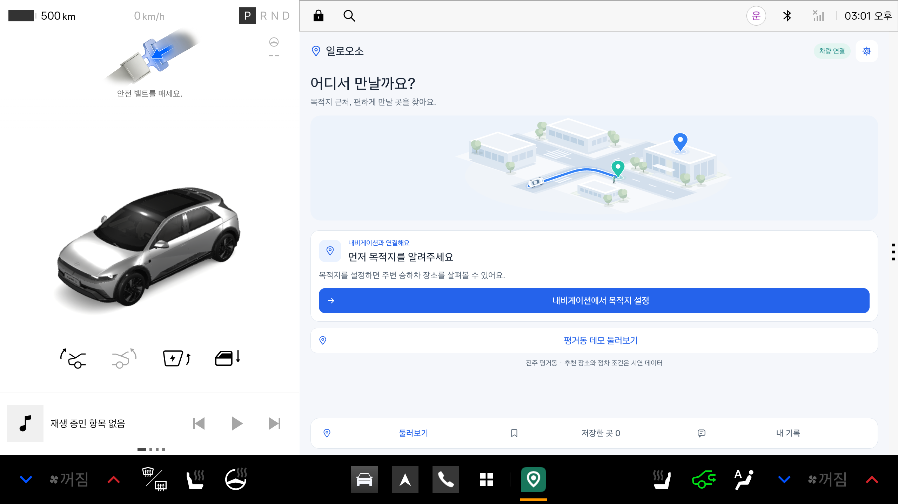

# Pleos 디자인 업데이트 검증

클라이언트 날짜: 2026-11-14 (Asia/Seoul). Android 에뮬레이터 내부 시계와 구분합니다.

## 변경

- 9–13sp 중심의 작은 글자를 본문 24sp, 버튼 26sp, 제목 40–44sp로 재정리했습니다. 보조 문구는 20sp, 지도 라벨은 최소 18sp입니다.
- 밝은 회색 바탕, 흰 카드, 선명한 블루 액션과 민트 픽업 표시를 적용했습니다. 기본 아이콘은 Canvas 벡터로 통일했습니다.
- 첫 화면에는 도시 일러스트, 목적지 안내, 데모 진입을 배치했습니다. 필터는 탐색 시작 후 표시합니다.
- 탐색·저장·기록을 하단에 고정하고, 1200dp 미만에서는 지도와 목록을 세로로 배치했습니다.
- 도식 지도에 건물 깊이·블루 경로·민트 후보 마커를 적용했습니다. 확대 배율과 독립적인 라벨 크기와 마커 접근성 노드를 유지했습니다.
- 대화상자·입력·상세 정보·QR 크기를 조정했습니다. 지도는 여전히 시연용 도식입니다.
- 지원 지역 밖에서 저장 장소를 열면 데모로 전환하여 중앙 목적지를 유지합니다. 데모 안내 타이머에는 요청 ID·장소·모드 검사를 추가했습니다.

## 실행 검증

- `:app:assembleDebug :app:testDebugUnitTest` 성공, JUnit 10개 / 실패 0 / 오류 0.
- 실제 Pleos 2.1.0 AVD `emulator-5554`에 업데이트 설치 및 실행 성공.
- 설치 패키지: `ai.illooso.app`, versionCode 2, versionName `1.1.0-design`.
- 새 첫 화면의 도시 일러스트·문구·버튼·하단 탐색을 Android Studio Running Devices에서 확인했습니다. 캡처는 Android Studio의 Take Screenshot → Save로 저장했습니다.
- `AndroidRuntime:E` 조회에 앱 크래시 기록이 없었습니다.
- 전달 APK: `artifacts/illooso-pleos-debug.apk`. SHA-256은 `apk-sha256.txt`를 참고하세요.

## 검증 한계

최종 캡처는 넓은 앱 영역입니다. 841dp 분할 영역은 한 열로 변경했지만 실제 좁은 영역의 시각적 재검증은 남아 있습니다. Android Studio의 분리된 Running Devices 창에서 입력이 뒤쪽 프로젝트 창으로 전달되는 문제가 반복되었습니다. 패널을 고정하여 화면 절전 해제와 캡처는 수행했지만, 리디자인 후 장소 선택·저장·필터·공유·제보의 전체 터치 E2E는 완료하지 못했습니다. 도메인 단위 테스트 통과와 전체 UI 동작 검증은 구분합니다.

이번 변경은 일로오소 앱 디자인 업데이트입니다. 중앙 순정 내비게이션 배경 지도 공백 문제의 복구를 뜻하지 않습니다. 이전 지도 조사 기록은 `central-navigation-map-2026-11-13.md`에 있습니다.
