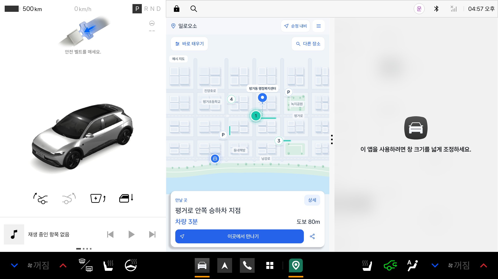

# 지도 고정 및 정보 패널 개편

버전 `1.3.0-map` / versionCode 4. 클라이언트 날짜 2026-11-14 (Asia/Seoul). 에뮬레이터 내부 시계와 날짜가 다릅니다.

## 정보 구조

- 기본 화면의 전체 ScrollView, 소개 배너, 상시 검색창, 장소 카드 나열, 하단 탭 바를 제거했습니다.
- 지도, 선택 장소 이름, 차량 예상 이동 시간, 도보 거리, 주요 행동을 한 화면에 고정합니다. 평거동은 내부 기본값으로 유지합니다.
- `다른 장소`는 지도 위 장소 찾기 패널을 엽니다. `상세`는 진입 방향·시간·요금·추가 우회 거리·이용자 경험을 담은 패널을 엽니다. 메뉴에서 저장한 곳, 내 기록, 앱 정보를 엽니다.
- 패널 제목·닫기는 고정이고 본문만 스크롤합니다. 낮은 높이에서도 목록이 사라지지 않도록 검색·탭도 패널 본문에 포함합니다.
- 740dp 이상 폭에서는 화면 폭의 48%(최대 540dp)인 왼쪽 패널을 사용합니다. 841dp 분할 영역에서 목적지 핀과 현재 선택 지점이 패널 옆에 보입니다. 더 좁은 창에서는 낮은 패널로 전환합니다.
- 같은 PickupMapView 인스턴스를 유지합니다. 패널 열기·닫기에서 지도 위치·배율·하단 카드가 바뀌지 않습니다. 지도 좌표·터치·접근성 범위는 상하 컨트롤 여백을 함께 반영합니다.
- 핵심 장소명 36sp, 차량 시간 34sp, 도보 거리 30sp, 주요 버튼 26sp를 사용합니다. 작은 높이에서는 핵심 글자를 26–30sp로 조정합니다. 지도 라벨은 18sp 이상입니다.
- 지도는 `예시 지도` 배지 하나로 구분하고, 중복 범례·나침반·차량 말풍선·장식 도로 표시를 줄였습니다.

## 상태와 기능

- 주행 제한이 활성화되면 열린 패널·대화상자를 닫고, 지도와 선택 요약을 읽기용으로 유지합니다. 검색·장소 선택·필터·공유·제보·SDK 요청은 잠깁니다. 지도 키보드 및 접근성 클릭도 차단합니다. 정책을 알 수 없을 때는 확인 대기 화면을 표시합니다.
- 필터·이용 목적을 바꾸면 대기 상태의 선택은 적격 후보로 재검사합니다. 후보가 없으면 빈 상태를 표시합니다. 안내 준비·안내 중·도착 상태에서는 현재 선택을 유지합니다.
- 저장된 장소가 선택한 시간에 닫혀 있으면 메인 카드에 이용 불가 상태와 다른 장소 찾기를 표시합니다.
- 패널의 빈 부분을 눌러도 아래 지도 마커로 터치가 통과하지 않습니다.
- 제보 수정은 현재 지도에서 선택한 장소를 덮어쓰지 않습니다. 순정 내비 화면 요청 오류는 토스트로 알립니다.

## 참고한 공식 문서

- [Pleos UI Design Guide](https://document.pleos.ai/en/docs/connect/guide/docs-design/Introduction/intro): 짧은 시간에 파악할 수 있는 핵심 정보, 높은 대비, 간결한 문구.
- [Android Map + Content](https://developer.android.com/design/ui/cars/guides/templates/map-content-template): 지도와 목록·상세를 함께 표시하고 관련 장소에 집중.
- [Apple CarPlay HIG](https://developer.apple.com/design/human-interface-guidelines/carplay): 간결한 레이아웃과 명확한 주요 콘텐츠.
- [Pleos Driving Safety](https://document.pleos.ai/en/docs/pleos-only/vehicle-app-planning-guide/driver-distraction-guideline): 운전자 주의 분산을 고려한 UI와 차량 UX 제한 대응.

공식 문서는 설계 참고 자료이며, 이 앱이 Android/CarPlay 템플릿을 사용하거나 차량용 인증을 충족한다는 뜻은 아닙니다. 실제 물리 글자 크기·주행 시인성 검증은 별도입니다.

## 검증 결과

- `:app:assembleDebug`와 `:app:testDebugUnitTest` 성공. JUnit **15개**, 실패·오류 0.
- 기존 추천·저장 관련 테스트 11개와 선택 유지 정책 테스트 4개를 실행했습니다. 시간 변경에 따른 재선택, 도보100m+주차장 빈 결과, 안내 진행 중 선택 유지, 적격 선택 유지와 초기 선택을 검증합니다.
- 실제 Pleos 2.1.0 AVD `emulator-5554`에 업데이트 설치했습니다. 설치된 버전 `1.3.0-map`을 확인했습니다.
- 841dp 분할 앱 영역에서 시작 시 지도·선택 카드·주요 버튼이 스크롤 없이 표시되는 것을 확인했습니다. `다른 장소` 버튼을 직접 조작해 패널을 열고, 최종 왼쪽 패널 옆으로 목적지·선택 핀과 하단 카드가 유지되는 것을 확인했습니다.
- 이후 사용자 조작으로 앱이 오른쪽 영역으로 이동한 상태에서도 레이아웃 유지, 다른 장소 선택과 QR 표시를 관찰했습니다. 해당 조작은 에이전트가 통제한 회귀 테스트로 계산하지 않습니다.
- 이번 실제 화면 점검은 기본 화면·패널 배치 중심입니다. 패널 스크롤 전체, 작은 높이/키보드, 주행 제한 전환, 안내 미리보기 전체와 제보 CRUD, 실제 SDK 경로 성공은 이번 버전에서 직접 끝까지 재검증하지 않았습니다. 관련 코드 검토와 도메인 테스트 결과를 실제 차량 검증으로 확대 해석하지 않습니다.

캡처는 Android Studio의 Take Screenshot → Save로 저장했습니다. 홈 캡처 이후 패널 폭·스크롤·선택 정책을 보완했으며 기본 홈 배치는 동일합니다. 전달 APK와 빌드 APK는 동일하며 SHA-256은 `apk-sha256.txt`에 있습니다.

## 유지한 범위

앱 내 지도·좌표·시설·조건은 예시 데이터이고 기본 안내는 로컬 미리보기입니다. 실제 SDK 경로 요청은 메뉴 → 앱 정보 및 설정 → 연동 점검에서 별도 확인을 거칩니다. 순정 내비게이션 배경 지도 공백은 이번 앱 레이아웃 변경으로 해결되지 않았습니다. 기존 [조사 기록](central-navigation-map-2026-11-13.md)을 유지합니다.
