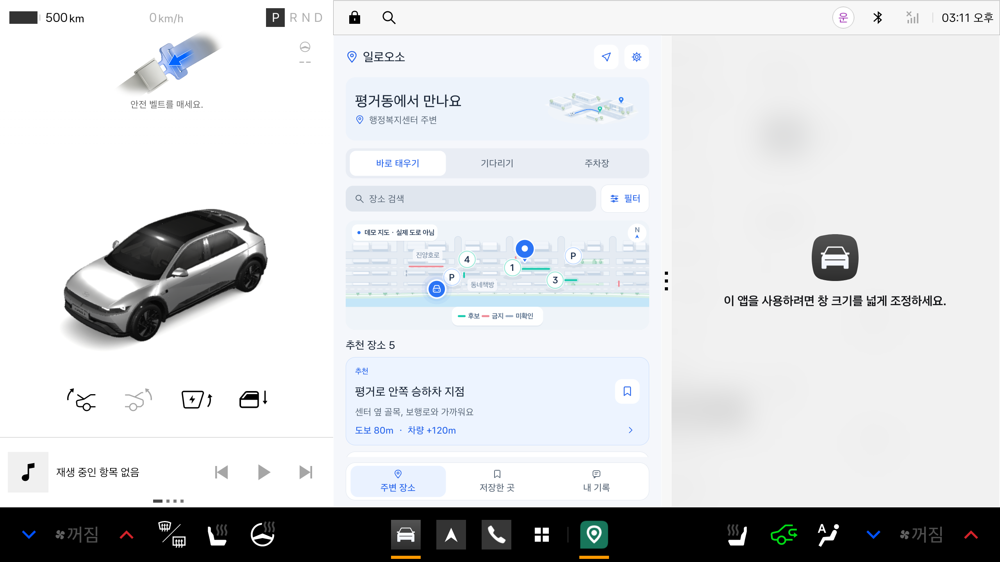

# 평거동 기본 화면 및 레이아웃 단순화

버전: `1.2.0-simple` / versionCode 3. 날짜는 클라이언트 기준 2026-11-14 (Asia/Seoul)이며 에뮬레이터 내부 시계와 다릅니다.

## 반영

- 실행 시 평거동 행정복지센터 주변의 추천 지도를 바로 표시합니다. 목적지 설정 안내, 데모 진입 버튼, 일반 화면의 데모/실제 모드 전환을 제거했습니다.
- 고정된 앱 추천 목적지는 순정 내비게이션 목적지와 독립적입니다. 시작·필터·저장·안내 미리보기에서 실제 목적지를 변경하지 않습니다.
- 기존 밝은 배경·블루·민트·도시 일러스트를 유지하고, 소개 영역을 작은 배너로 줄였습니다.
- 시간과 도보 거리를 하나의 필터 대화상자로 통합했습니다. 적용 전 변경은 반영되지 않으며 취소/초기화를 제공합니다.
- 카드 전체를 상세 진입 영역으로 사용하고 중복된 자세히 버튼을 제거했습니다.
- 저장 화면은 탐색 필터와 독립적인 저장 목록입니다. 지도·모드·검색 필터를 반복하지 않습니다.
- 상세에서는 뒤로가기·저장 아이콘과 하단에 고정된 주요 동작·공유 버튼을 사용합니다.
- 실제 SDK 경로 요청은 장소 선택 후 앱 정보 → 연동 점검 안에 있으며 기존 확인 절차를 유지합니다. 차량 UX 제한 확인도 유지합니다.

## 검증

`assembleDebug`와 `testDebugUnitTest` 성공. JUnit 11개, 실패 0, 오류 0. 저장 장소가 탐색 시간·모드·거리 필터 때문에 사라지지 않도록 회귀 테스트를 추가했습니다.

실제 Pleos 2.1.0 AVD `emulator-5554`에 업데이트 설치했습니다. Android Studio Running Devices에서 841dp 분할 앱 영역으로 아래 흐름을 직접 조작했습니다.

1. 앱 시작 → 평거동 지도·추천 5곳 표시, 첫 추천 카드가 하단 탐색 위에 표시됨.
2. 추천 카드 선택 → 상세 표시, 하단 고정 버튼 확인.
3. 저장 아이콘 → 저장 표시 반영.
4. 이곳에서 만나기 → 안내 미리보기 활성화 및 도식 경로 표시 → 도착 확인 → 도착 문구·이용 경험 남기기 버튼 표시.
5. 필터 → 최대 도보 100m 선택 → 적용 → 추천 5곳에서 1곳으로 감소, 지도 마커와 적용 상태 갱신.
6. 저장한 곳 → 저장 장소 표시 → 점검용 저장 취소 → 빈 상태 표시.
7. 빈 상태의 주변 장소 보기 → 기본 필터와 추천 5곳으로 복귀. 점검용 저장 항목은 남기지 않았습니다.

캡처는 Android Studio Take Screenshot → Save로 저장했습니다. 전달 APK와 빌드 APK는 동일하며 SHA-256은 `apk-sha256.txt`에 있습니다.

## 범위

지도·좌표·시설·규정은 여전히 예시 데이터이고 기본 안내는 시뮬레이션입니다. 이번 점검은 위 사용자 흐름을 대상으로 하며 실제 SDK 경로 탐색 성공·QR 공유·제보 작성 전체·넓은 화면 재점검을 포함하지 않습니다. 순정 내비게이션 배경 지도 공백 조사 결과는 기존 기록을 유지합니다.
